# Cap Tower Defense

A 3D tower-defense game that runs in your browser. Flying saucers are invading:
build towers along their road, upgrade them and stop every wave before it reaches
your keep. Fight your way across five regions of a 3D island, earn crystals and
stars, and spend them on permanent upgrades.

### ▶ [Play it now](https://imnotcap.github.io/cap-towerdefense-ai/)

Nothing to install. It runs in any modern browser on desktop, tablet and phone
(WebGPU where available, WebGL2 otherwise). Progress is saved in your browser.

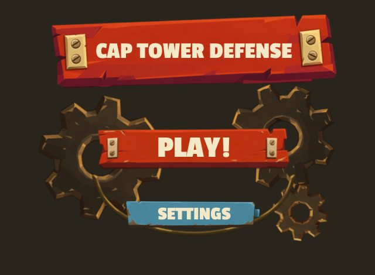

---

## Features at a glance

- **A 3D world map** with 5 themed regions and 25 stages to conquer.
- **Every battle map is different:** generated roads, rivers, forests and landmarks
  in a style that matches each region.
- **3 towers with 3 levels each:** Cannon, Ballista and Turret. Upgrades change the
  tower's model, and you choose who each tower targets.
- **Waves of saucers** that get tougher as you go. Every stage ends with a boss.
- **Easy, Normal and Hard** for every stage, with stars to earn.
- **The Armory:** spend crystals on permanent upgrades for towers, your commander
  and two special abilities.
- **Meteor Strike and Deep Freeze** abilities you can use in battle.
- **Built for touch as well as mouse and keyboard.** The whole interface adapts to
  phone screens.

---

## The campaign

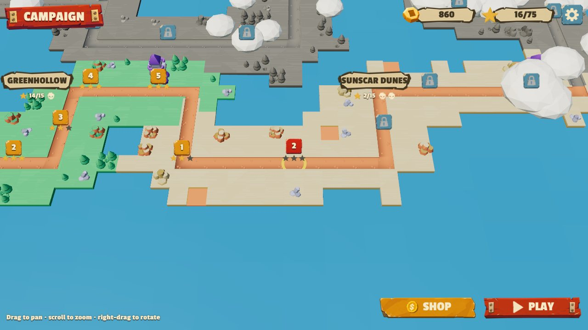

The campaign takes place on a 3D diorama island. One road links five regions, each
with five stages and its own look, enemies and difficulty:

| Region | Landscape | Difficulty |
|---|---|---|
| **Greenhollow** | Rolling farmland, streams with bridges, timber watchtowers | ★ |
| **Sunscar Dunes** | Scorched desert, dune fields, sand-buried ruins | ★★ |
| **Frostpeak** | Frozen passes, pine forests, ice crystals | ★★★ |
| **Emberforge** | Basalt fields lit by rivers of lava, ruined forges | ★★★★ |
| **Umbral Spire** | The invaders' stronghold: dark crystal groves and void streams | ★★★★★ |

- **Unlocking:** clear a stage to open the next one. Locked regions sit greyed out
  under drifting clouds until you reach them.
- **Moving around:** drag to pan the map, scroll or pinch to zoom, right-drag or
  two-finger drag to rotate. Tap a region's banner to fly there.
- **Stage markers** show the stars you've earned. The next stage to play bounces.

### Before each battle

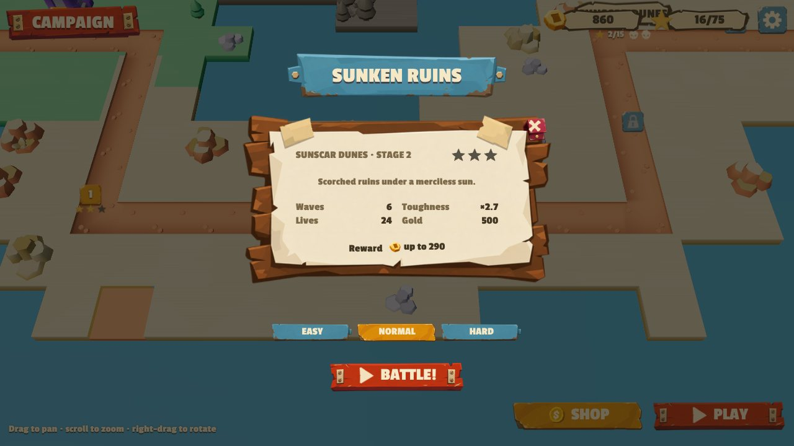

Each stage card shows the number of waves, how tough the enemies are, your lives,
your starting gold and the crystal reward. Then pick a difficulty:

| Difficulty | Enemy health | Crystal reward |
|---|---|---|
| Easy | 75% | 70% |
| Normal | 100% | 100% |
| Hard | 160% | 160% |

---

## Battles

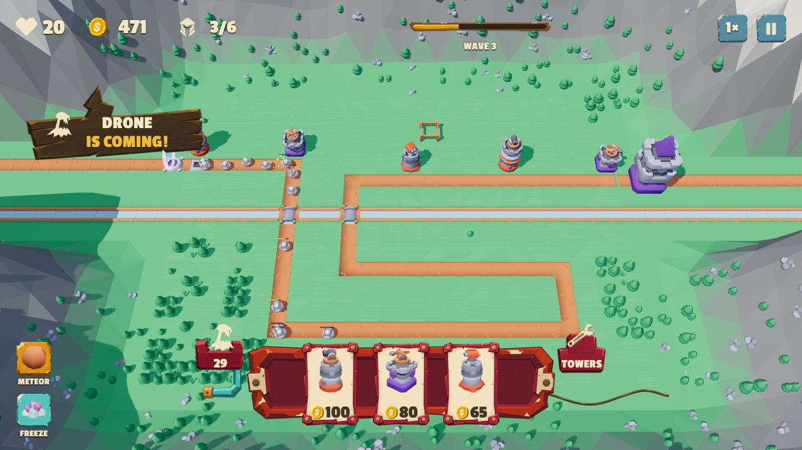

Saucers come out of a portal and fly along the road towards your keep. Each one that
gets through costs lives. Lose them all and the battle is lost.

- **Waves:** stages have 5 to 11 waves, and enemies get tougher with every wave.
  A warning sign tells you which saucer is coming.
- **Bosses:** the last wave of every stage brings a boss mothership, two on a
  region's final stage. A boss has a huge amount of health, costs 5 lives if it
  gets through and pays 150 gold when destroyed.
- **Next wave:** a tab beside your tower cards shows how big the next wave is.
- **Call waves early** for bonus gold, or wait for them to start on their own.
- **Normal or double speed** with the 1×/2× button.

### Building towers

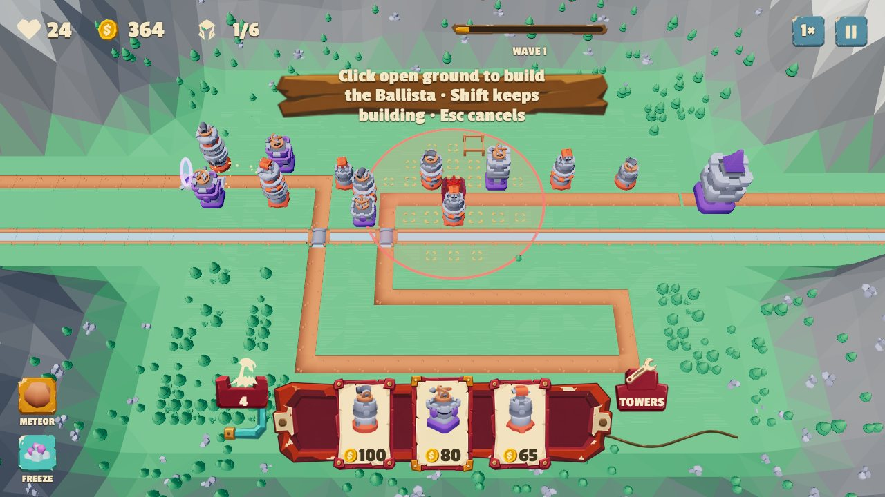

Pick a tower card, then tap or click open ground to build. A see-through ghost of the
tower and its range circle follow your pointer: green where it can go, red where it
can't. You can build on any open tile that isn't road, trees, rocks or crystals, and
the tiles next to the road are always open.

| Tower | Cost | Strengths |
|---|---|---|
| **Cannon** | 100 | Slow, heavy shells that hit everything in a splash |
| **Ballista** | 80 | Long range, piercing bolts |
| **Turret** | 65 | Short range, rapid fire |

### Upgrading and selling

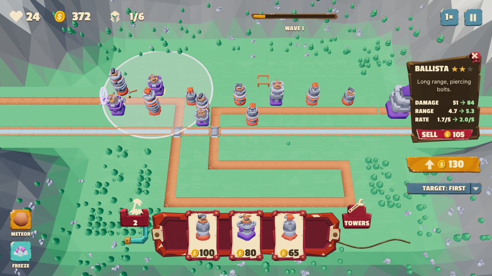

Tap a tower to open its info panel. It shows the tower's damage, range and fire rate
now and after the next upgrade.

- **Upgrade:** towers go up to level 3, and each level builds the tower taller.
- **Sell:** you get 70% of everything you spent on the tower back.
- **Targeting:** choose *First* (closest to your keep), *Last*, *Strong* (most
  health) or *Close* (nearest to the tower).

### Abilities

Bought in the Armory, then used during battle:
- **Meteor Strike:** tap the map to drop a meteor on a crowd of saucers.
- **Deep Freeze:** slows every saucer on the map for a few seconds.

### Pause, victory and stars

| | |
|---|---|
| 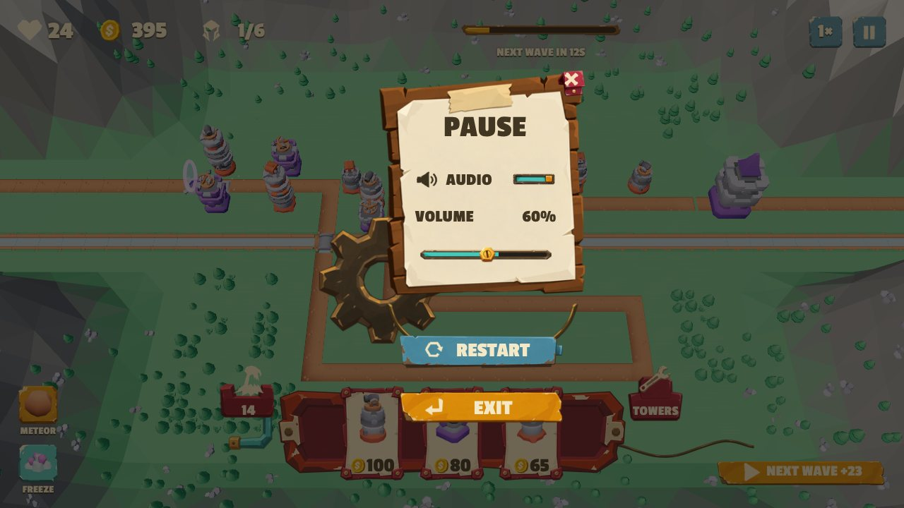 | 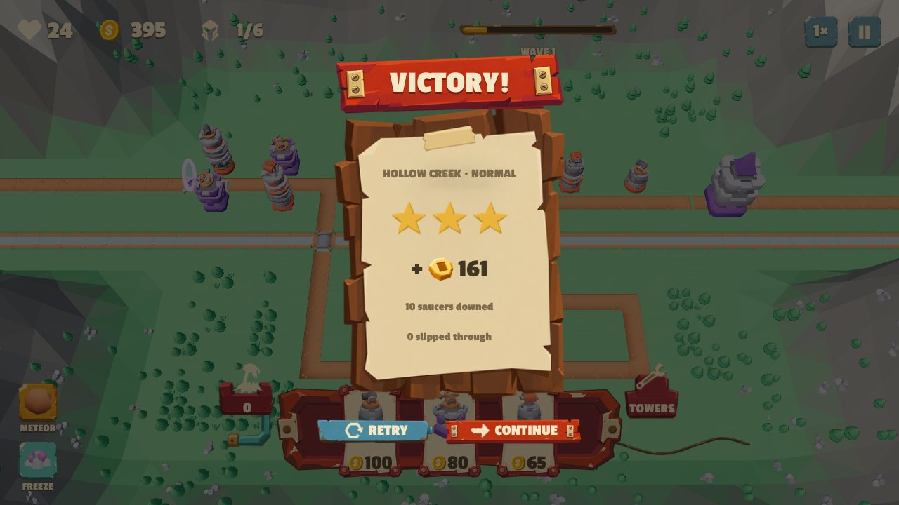 |

The pause menu has sound settings and lets you restart or leave the battle. When you
win you earn stars and crystals:

- **★★★** no lives lost
- **★★** at least half your lives left
- **★** you survived

The first clear of a stage pays 50% extra crystals.

---

## The Armory

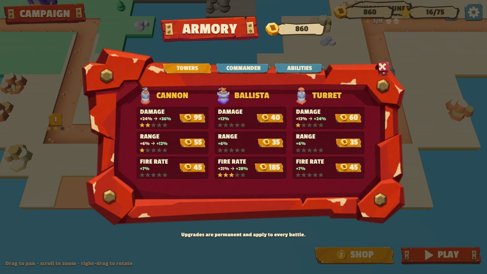

Crystals earned in battle buy permanent upgrades that apply to every battle:

| Tab | Upgrades |
|---|---|
| **Towers** | Damage (+12% per level), Range (+6%) and Fire rate (+7%) for each tower, 5 levels each |
| **Commander** | Fortified Base (extra lives), Bounty Hunter (more crystals), Sharpshooter (double-damage chance), War Chest (more starting gold), Engineering (cheaper towers), Salvage Crew (better sell refund), Quick Hands (shorter ability cooldowns) |
| **Abilities** | Unlock Meteor Strike and Deep Freeze, then make them stronger |

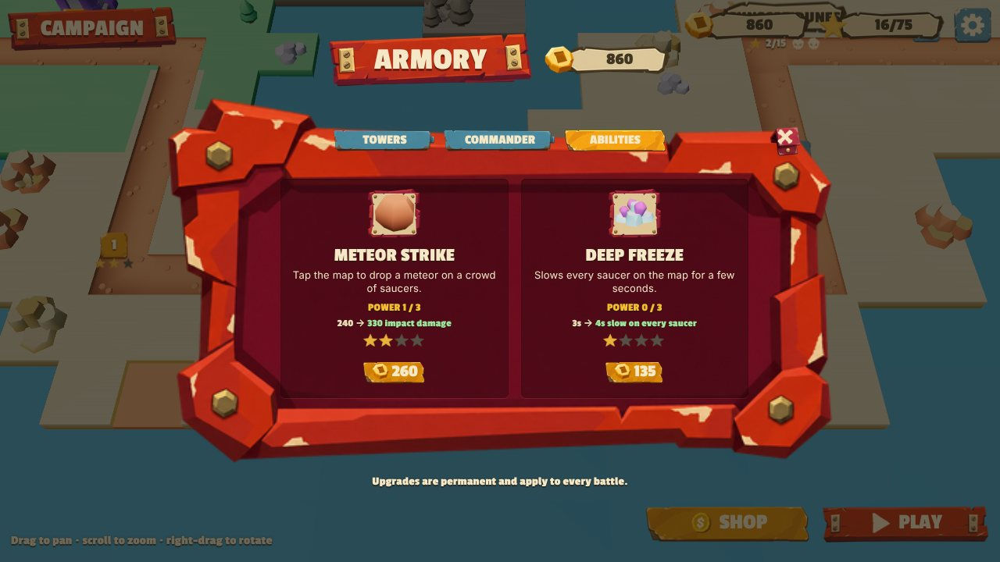

---

## On your phone

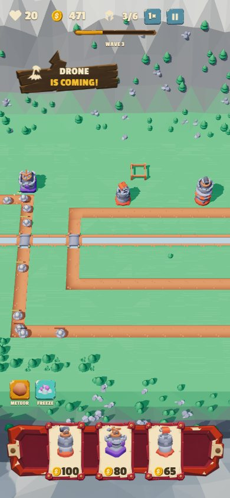

The game is fully playable on a phone.
- **Placing towers:** the first tap shows the ghost tower and its range, and a second
  tap on the same tile builds it.
- **Camera:** it starts closer to the action. Drag with one finger to pan, pinch to
  zoom, and use two fingers to rotate.
- **Layout:** every panel and menu resizes to fit the screen.

---

## Controls

| Action | Mouse & keyboard | Touch |
|---|---|---|
| Pick a tower | Click a card, or press **1**, **2**, **3** | Tap a card |
| Build | Click open ground (hold **Shift** to keep building) | Tap a tile, then tap it again |
| Cancel | **Esc** | Tap the card again |
| Upgrade / sell | Tap the tower, then **U** / **S** | Tap the tower, then use the panel |
| Call the next wave | **Space** | The wave button |
| Pause | **P** or **Esc** | The pause button |
| Move the camera | Drag, scroll wheel, right-drag | Drag, pinch, two-finger drag |

---

## Under the hood

- **Tech:** written in TypeScript with [three.js](https://threejs.org/), on its
  WebGPU renderer, which falls back to WebGL2 when WebGPU isn't available.
- **Performance:**
  - The simulation runs at a fixed 60 ticks per second with zero allocations per tick.
  - Enemies, towers and projectiles are GPU-instanced, and a stage's scenery is
    batched into about 16 draw calls.
  - Simulating 5,000 saucers takes under 1 ms per tick on the CPU.
- **No server:** the whole game is a static site, deployed to GitHub Pages
  automatically on every push.

Developer documentation (how to run it locally, the code layout and benchmarks) is
in [`web/README.md`](web/README.md).

```bash
cd web
npm install
npm run dev    # http://localhost:5173
```

## Credits

- 3D models: [Kenney Tower Defense Kit](https://kenney.nl/assets/tower-defense-kit) (CC0)
- Interface: the Scrapworks UI pack (made for this project); UI sounds from the
  [Kenney UI Pack](https://kenney.nl/assets/ui-pack) (CC0)
- Font: [Passion One](https://fonts.google.com/specimen/Passion+One) (SIL Open Font License)

The code is licensed under the [GNU GPL v3](LICENSE).
